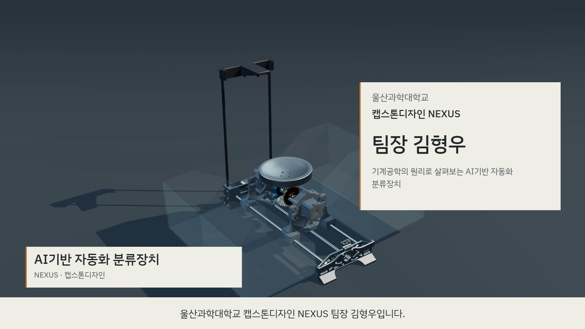
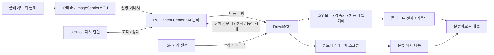
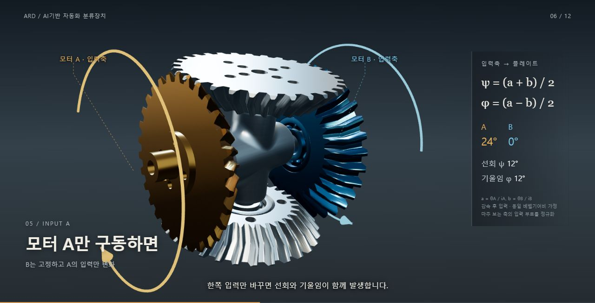
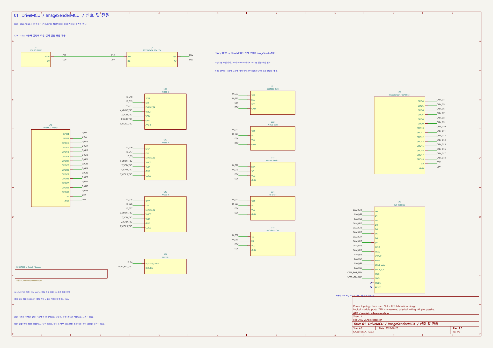
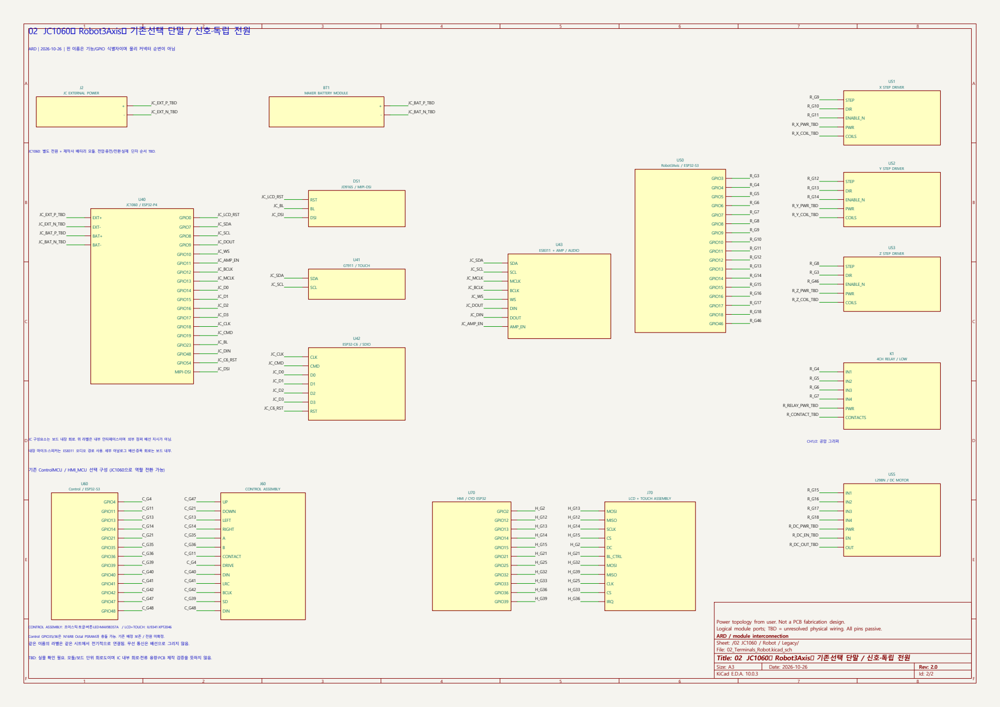

# ARD — AI기반 자동화 분류장치

**카메라로 물체를 분석하고, 레일과 차동 베벨기어로 플레이트를 움직여 분류하는 장치입니다.**

비전 카메라의 이미지, PC의 AI 분석, ESP32 기반 구동 제어를 하나의 흐름으로 연결합니다. 두 모터의 회전을 조합해 플레이트의 선회와 기울임을 만들고, 리니어 레일로 배출 위치를 바꿉니다. 현재 소개하는 분류장치는 플레이트 방식이며, 저장소에 함께 보관된 3축 로봇·공압 그리퍼는 별도 개발 구성입니다.


| 바로 보기 | 자료 |
|---|---|
| 작품 소개 영상 | [3분 전체 발표 영상 재생·다운로드](https://media.githubusercontent.com/media/khw1566/ARD/ard-v1/output/ard-cg/final/ARD_FullPresentation_1080p_v2.mp4) · [한국어 대사 SRT](output/ard-cg/final/ARD_FullPresentation_1080p_v2_Korean.srt) |
| 전체 회로도 | [2쪽 PDF](output/kicad/ARD_2Sheet/ARD_2Sheet_회로도.pdf) · [편집 가능한 KiCad 프로젝트](output/kicad/ARD_2Sheet/ARD_2Sheet.kicad_pro) · [KiCad 전체 묶음 ZIP](output/kicad/ARD_KiCad_2Sheet_261026.zip) |
| 전체 3D 모델 | [Inventor 기준 조립체](ARD_Model_v2.iam) · [전체 STL](<영상제작용 CAD파일/ARD_Model_v2.stl>) |
| 부품별 3D 모델 | [모델 목록과 열기 방법](docs/3d-models.md) · [원본 STL·도면 이미지 폴더](<영상제작용 CAD파일>) |
| 시스템 구성 문서 | [시스템·전원·주요 GPIO 설명 PDF](output/pdf/ard_system_2p/ARD_시스템_회로구성_2장.pdf) |

## 작품 소개 영상

[](https://media.githubusercontent.com/media/khw1566/ARD/ard-v1/output/ard-cg/final/ARD_FullPresentation_1080p_v2.mp4)

**[영상 재생·다운로드](https://media.githubusercontent.com/media/khw1566/ARD/ard-v1/output/ard-cg/final/ARD_FullPresentation_1080p_v2.mp4)** · [저장소의 영상 파일](output/ard-cg/final/ARD_FullPresentation_1080p_v2.mp4) · [한국어 대사 SRT](output/ard-cg/final/ARD_FullPresentation_1080p_v2_Korean.srt) · [음원·서체 크레딧](output/ard-cg/final/PRESENTATION_v2_CREDITS.txt)

3분, 1920 × 1080, 30fps의 전체 발표 영상입니다. 작품 소개, CAD 기반 기계 원리 설명, 실물 구동 시연을 연결했습니다. 유성감속기와 차동 베벨기어의 전달 관계를 단면·확대 장면으로 설명하고, 실물 구간에는 한국어 설명과 자막을 넣었습니다. 실물 구간은 수동 조작 시연이며 자동 분류 성능 시험과 구분합니다.

영상 원본은 약 162MB이며 Git LFS로 보관합니다. 위 썸네일을 누르면 영상 파일이 열립니다. 브라우저 설정에 따라 재생되거나 다운로드됩니다. 저장소를 복제한 뒤 영상이 작은 텍스트 파일로 보이면 다음 명령으로 해당 영상을 받습니다.

```powershell
git lfs install
git lfs pull --include="output/ard-cg/final/ARD_FullPresentation_1080p_v2.mp4"
```

## 작품 개요

물체 인식과 모터 구동은 서로 다른 시간 특성을 가집니다. ARD는 PC가 이미지 분석과 분류 순서를 담당하고, DriveMCU가 일정한 주기로 모터 펄스와 센서 제어를 수행하도록 구성했습니다. 터치 단말인 JC1060은 상태 확인과 조작을 맡으며, 모터는 PC를 거쳐 DriveMCU에서 구동합니다.

| 구성 | 역할 | 관련 자료 |
|---|---|---|
| 비전 카메라 / ImageSenderMCU | ESP32-S3에서 DVP 카메라 이미지를 촬영하고 PC로 전송 | [펌웨어 설명](ARD_ESP-IDF/ImageSenderMCU/README.md) |
| PC Control Center | 이미지 AI 분석, 분류 시퀀스, 명령 전송, 상태 표시, 3D 시각화 | [PC 프로그램](ARD_MAIN) |
| DriveMCU | ESP32에서 X/Y 차동 구동과 Z 레일 구동, ToF 거리 피드백, OLED 상태 표시 | [펌웨어 설명](ARD_ESP-IDF/DriveMCU/README.md) |
| JC1060P470C | ESP32-P4/C6 기반 7인치 터치 조작, 상태 모니터링, 내장 마이크·스피커 | [통합 단말 설명](ARD_ESP-IDF/JC1060P470C/README.md) |
| 기계 구조 | 플레이트, 차동 베벨기어, 유성감속기, 리니어 스크류, 분류함 | [3D 모델 안내](docs/3d-models.md) |



## 3D 모델링과 기계 구조

### 전체 조립체

사용자가 지정한 기준 조립체는 **`ARD_Model_v2.iam`**입니다. 상단 카메라 지지대, 중앙 플레이트와 차동 구동부, 하부 레일·스크류, 주변 분류함으로 구성됩니다. 전체 STL의 좌표축별 외곽 크기는 약 **502.47 × 440.00 × 594.50 mm**입니다. 이는 내보낸 메쉬의 경계 상자 크기이며, 각 축이 실물의 가로·세로·높이와 일치하는지는 모델 방향을 기준으로 확인해야 합니다.

Inventor 조립체는 부품 참조를 포함하므로 `.iam` 파일 하나만 받아서는 일부 참조가 누락될 수 있습니다. 형상을 먼저 확인하려면 전체 STL을 사용하고, 부품·구속조건을 편집하려면 저장소의 관련 `.ipt`·`.iam` 파일을 함께 준비합니다. STL의 치수 단위는 **mm**이며, 가져오는 프로그램에서도 mm를 선택합니다.


### 차동 베벨기어: 두 모터로 두 운동 만들기

모터 A와 B의 회전은 양측 감속기를 거쳐 서로 마주 보는 베벨 입력축으로 전달됩니다. 두 입력의 조합으로 플레이트가 자기 축 주위를 도는 **선회**와, 플레이트를 기울여 물체를 배출하는 **기울임**을 만듭니다. 중앙 십자 조인트와 출력축을 분리해 보면, 기울어지는 지지 구조와 그 안에서 선회하는 출력부의 관계를 확인할 수 있습니다.



위 이미지는 CAD를 이용한 원리 설명용 시각화입니다. 금색과 파란색은 두 입력축을 구분하기 위한 표시입니다.

각 모터의 회전각을 `θA`, `θB`, 감속비를 `iA`, `iB`라고 하면, 감속 후 입력각은 다음과 같습니다.

```text
a = θA / iA
b = θB / iB

플레이트 선회각   ψ = (a + b) / 2
플레이트 기울임각 φ = (a - b) / 2

목표 자세에서 구하는 모터 입력각:
θA = iA × (ψ + φ)
θB = iB × (ψ - φ)
```

| 감속 후 정규화된 입력 | 선회 ψ | 기울임 φ | 결과 |
|---|---:|---:|---|
| `a=q`, `b=q` | `q` | `0` | 선회 |
| `a=q`, `b=-q` | `0` | `q` | 기울임 |
| `a=q`, `b=0` | `q/2` | `q/2` | 두 운동이 함께 발생 |
| `a=0`, `b=q` | `q/2` | `-q/2` | 선회와 반대 부호의 기울임이 함께 발생 |

두 모터는 서로 마주 보므로 여기서 같은 부호는 **공통 좌표계로 정규화한 입력 방향**을 뜻합니다. 각 모터를 정면에서 보았을 때의 시계 방향과 동일하게 해석하면 안 됩니다. 위 식은 동일한 베벨기어비와 이상적인 강체 전달을 가정합니다. 설치 방향·실제 기어비·백래시·하중·탈조의 영향은 별도 확인이 필요합니다.

관련 모델: [베벨기어 조립체](<영상제작용 CAD파일/베벨기어 조립체.stl>) · [중심 십자 조인트](<영상제작용 CAD파일/베벨기어 중심 십자조인.stl>) · [베벨기어와 플레이트](<영상제작용 CAD파일/베벨 기어 및 플레이트.stl>)

### 유성감속기: 입력 네 바퀴에 출력 한 바퀴

사용자가 확인한 잇수는 태양기어 **16**, 행성기어 **16**, 링기어 **48**입니다. 링기어를 고정하고 태양기어를 입력으로, 캐리어를 출력으로 사용합니다. 행성기어는 자전하면서 태양기어 주위를 공전하고, 캐리어가 그 공전 운동을 출력합니다.

```text
감속비 i = 1 + 링기어 잇수 / 태양기어 잇수
         = 1 + 48 / 16
         = 4
```

따라서 이상적인 속도 관계에서 입력 4회전에 캐리어가 같은 방향으로 1회전합니다. 실제 출력 토크는 마찰과 전달 효율의 영향을 받으므로 감속비만으로 실측 토크를 확정하지 않습니다.

관련 모델: [유성기어 감속기](<영상제작용 CAD파일/유성기어 감속기.stl>) · [커버·베어링 제거 모델](<영상제작용 CAD파일/커버와 베어링이 제거된 감속기.stl>)

### 리니어 레일과 분류 동작

Z축은 리니어 스크류로 상부 분류 구조를 이동합니다. 여기서 Z는 프로그램의 레일 축 이름입니다. 회전축 X/Y와 레일 축 Z를 조합해 분류함 위치와 배출 방향을 결정합니다. ToF 센서는 레일 방향의 거리를 측정하며, PID 모드에서는 목표 거리와 현재 거리의 차이를 이용해 이동을 제어합니다. 개루프 모드는 스텝 수와 거리 환산값을 사용합니다.

현재 자동 분류 코드의 기본 흐름은 **수평 복귀 → 새 이미지 촬영 → AI 분석 → 레일 위치 이동 → 플레이트 전도 → 복귀**입니다. 현재 분류 경로는 레일 위치와 앞·뒤 기울임을 조합하며, 선회각 목표는 0으로 둡니다. 기구 설명용 3D 장면에서는 별도로 선회와 복합 운동도 보여줍니다.

관련 모델: [상부 이송 구조](<영상제작용 CAD파일/상부이송구조.stl>) · [하부 이송 구조](<영상제작용 CAD파일/하부이송구조.stl>) · [전도 자세](<영상제작용 CAD파일/전도 과정 작동모습.png>)

## 전체 KiCad 회로도

**[전체 2쪽 회로도 PDF 열기](output/kicad/ARD_2Sheet/ARD_2Sheet_회로도.pdf)** · **[KiCad 프로젝트 전체 다운로드](output/kicad/ARD_KiCad_2Sheet_261026.zip)**

아래 두 시트가 저장소의 전체 모듈 연결 회로도입니다. KiCad 10 프로젝트에서 첫 장과 계층 시트인 둘째 장을 함께 열어 편집할 수 있습니다.

| 시트 | 수록 내용 | 원본 |
|---|---|---|
| 1. 구동·카메라·전원 | 12V 입력과 5V 스텝다운, DriveMCU, A4988 X/Y/Z 인터페이스, OLED·환경·ToF·GPS·부저, ImageSenderMCU와 DVP 카메라 | [루트 회로도](output/kicad/ARD_2Sheet/ARD_2Sheet.kicad_sch) |
| 2. 통합 단말·선택 구성 | JC1060의 P4/C6·화면·터치·오디오 연결, 독립 전원·배터리 모듈, 과거 Robot3Axis·ControlMCU·HMI 구성 | [계층 회로도](output/kicad/ARD_2Sheet/02_Terminals_Robot.kicad_sch) |

### 1장 — DriveMCU / ImageSenderMCU

[](output/kicad/ARD_2Sheet/ARD_2Sheet_회로도.pdf)

### 2장 — JC1060 / 기존 선택 단말

[](output/kicad/ARD_2Sheet/ARD_2Sheet_회로도.pdf)

### 회로도 읽기와 현재 구성의 차이

회로도는 **2026-10-26 기준 보드·모듈 연결 문서**입니다. 핀 번호는 GPIO 또는 기능 식별자이며, 물리 커넥터의 핀 순서를 뜻하지 않습니다. 동일 시트에서 이름이 같은 넷 라벨은 전기적으로 연결됩니다. IC 내부 회로나 PCB 패턴·제조 파일까지 포함하는 설계는 아닙니다.

- 전원은 사용자 설명에 따라 12V를 스텝다운한 5V 계통에서 DriveMCU·센서 모듈·ImageSenderMCU로 공급하는 구조로 표시했습니다. JC1060의 별도 전원과 제작사 배터리 모듈은 이 계통과 분리해 표시했습니다.
- **OLED는 도면에 SSD1306으로 남아 있지만, 이후 실제 교체 대상으로 확인된 모듈과 현재 DriveMCU 기본 설정은 1.3인치 SH1106 128×64입니다.** SDA GPIO22 / SCL GPIO23은 유지하며, 모듈 전원과 풀업 전압은 [최신 OLED 연결 설명](ARD_ESP-IDF/DriveMCU/README.md)을 기준으로 확인합니다. 도면의 모듈 5V 표기를 센서 IC·ESP32 GPIO의 5V 허용으로 해석하면 안 됩니다.
- A4988의 VMOT·VDD·코일 연결, 미확정 전원과 단자는 `TBD`로 표시했습니다. JC 배터리의 전압·충전 회로·단자 순서는 추정하지 않았습니다.
- 2장에 있는 로봇·그리퍼와 구형 단말은 저장소 전체 구성을 설명하기 위한 기록입니다. 현재 플레이트 분류장치에 모두 장착된다는 의미는 아닙니다.

기존 생성 기록에서 KiCad 출력 넷리스트의 **75개 신호 연결 일치**, ERC **오류 0 / 경고 26**을 확인했습니다. 경고는 미확정 단자에 관한 것으로 남겨 두었습니다. 이는 모듈 연결 자료의 일관성 확인이며, 부품 정격·실물 배선·PCB의 전기적 검증 결과는 아닙니다. 자세한 범위와 검증 파일은 [회로도 설명](output/kicad/ARD_2Sheet/README.md)에서 확인할 수 있습니다.

## AI 분석과 제어 소프트웨어

PC는 새로 촬영한 이미지에서 물체명과 재질 분류 결과를 받아 분류 위치로 변환합니다. 현재 코드에는 Gemini 이미지 분석 연동이 있으며, 모델과 API 키는 로컬 설정에서 관리합니다. 재질 응답은 다음 다섯 범주를 사용합니다.

| 분석 범주 | 표시 의미 |
|---|---|
| `Plastic` | 플라스틱 |
| `Metal` | 금속 |
| `Glass` | 유리 |
| `Paper` | 종이 |
| `Others` | 기타 |

분류함의 레일 위치와 기울임 방향은 보정 설정에 따라 결정됩니다. AI 응답 오류, 새 이미지 수신 실패, 센서 상태와 명령 ACK를 확인하며 분류를 진행합니다. 이미지로 추론한 재질은 실제 재질 검사와 다를 수 있으며, 이 저장소에서 분류 정확도나 처리량을 정량 성능으로 제시하지는 않습니다.

### 통신과 상태 표시

| 구간 | 구현된 경로 |
|---|---|
| PC ↔ DriveMCU | 선택한 COM 포트의 USB 시리얼 요청·응답 또는 TCP 5002 |
| JC1060 ↔ PC | Wi-Fi HTTP 또는 USB 터널을 통한 동일 PC API 요청 |
| ImageSenderMCU ↔ PC | Wi-Fi 이미지 전송 또는 USB 터널; 무선 이미지 프로토콜에는 CRC32·누락 청크 재전송을 사용하는 UDP 5001 경로 포함 |
| PC → 카메라 촬영 명령 | USB 터널 또는 TCP 5003 |
| 브라우저 ↔ PC | 기본 HTTP 5000, 상태 이벤트와 3D 화면 |

현재 소스의 PC 실행기는 연결된 보드를 검색해 USB 포트를 설정합니다. 연결 방식은 실행 설정과 보드 펌웨어에 따라 달라지며, USB 케이블이 있다는 사실만으로 해당 보드의 제어 경로를 단정할 수는 없습니다. 무선 사용 시에는 보드의 PC 서버 주소를 실제 PC 주소와 맞춰야 합니다.

PC 화면의 X/Y 각도는 **명령 스텝 또는 보드 위치 카운터에서 계산한 추정값**입니다. 엔코더로 측정한 절대각이 아닙니다. 레일 ToF 거리와 계산상 위치도 별도로 표시합니다. `zero`는 현재 위치 카운터를 0으로 바꾸는 동작이고, `home`은 기록된 0 위치로 복귀하는 동작이므로 기구 원점 센서 탐색과 구분합니다.

DriveMCU에는 비상정지, 연속 조그 입력 중단 시 정지, 가감속, ToF 상태·레일 범위 검사가 구현돼 있습니다. 현재 X/Y 각도 제한은 사용자 요청으로 해제돼 있으므로, 실제 기구의 간섭 범위와 기준 자세는 운전 전에 맞춰야 합니다.

## 자료 열기와 실행

### KiCad 회로도

1. 저장소 전체 또는 [KiCad ZIP](output/kicad/ARD_KiCad_2Sheet_261026.zip)을 받습니다.
2. KiCad 10에서 `output/kicad/ARD_2Sheet/ARD_2Sheet.kicad_pro`를 엽니다.
3. 루트 회로도와 `02_Terminals_Robot` 계층 시트를 확인합니다. `ARD2.kicad_sym`과 `sym-lib-table`을 같은 폴더에 유지합니다.

### CAD 기반 3D 시각화

브라우저에서 전체 조립체, 단면, 유성감속기와 차동 베벨기어의 운동 관계를 볼 수 있습니다. 준비 과정은 원본 STL에서 미리보기용 메쉬를 만들며 원본 CAD를 수정하지 않습니다.

저장소 루트에서 실행합니다.

```powershell
python -m pip install --only-binary=:all: -r output/ard-cg/requirements.txt
python output/ard-cg/prepare_cad.py
python output/ard-cg/serve.py
```

브라우저에서 `http://127.0.0.1:5187/cinematic.html`을 엽니다. 루트 주소의 `index.html`은 이전 시안이므로 위 경로를 사용합니다. 미리보기 메쉬인 `assets/`는 Git에서 제외되어 있어 처음 받은 환경에서는 생성 단계가 필요합니다.

### PC Control Center

Windows에서 Python을 설치한 후 저장소 루트에서 실행합니다.

```powershell
.\ARD_MAIN\setup_pc.bat
.\ARD_MAIN\run_pc.bat
```

브라우저 주소는 `http://localhost:5000`입니다. 설정 화면에서 API 키, 보드 연결, 카메라·감속비·레일 보정값을 맞춥니다. 키와 개별 PC의 설정은 저장소에 포함하지 않습니다. 펌웨어 빌드·업로드 방법과 보드별 설정은 각 [ESP-IDF 프로젝트](ARD_ESP-IDF)의 README를 확인합니다.

## 저장소 안내

| 위치 | 내용 |
|---|---|
| [`ARD_Model_v2.iam`](ARD_Model_v2.iam) | 현재 소개 기준 Inventor 조립체 |
| [`ARD_hardware/`](ARD_hardware) | 부품·조립체·기구 도면과 이전 설계 |
| [원본 CAD 자료](<영상제작용 CAD파일>) | 전체·부품별 STL과 조립·단면 이미지 |
| [`output/kicad/ARD_2Sheet/`](output/kicad/ARD_2Sheet) | 전체 2장 KiCad 프로젝트·PDF·미리보기·넷리스트 검증 자료 |
| [`output/pdf/ard_system_2p/`](output/pdf/ard_system_2p) | 시스템 구성·전원·GPIO 설명 문서 |
| [`output/ard-cg/`](output/ard-cg) | CAD 기반 3D 장면·기구학 리그·메쉬 준비 코드 |
| [`ARD_ESP-IDF/`](ARD_ESP-IDF) | DriveMCU·ImageSenderMCU·JC1060 및 기존 단말 펌웨어 |
| [`ARD_MAIN/`](ARD_MAIN) | PC 서버·웹 UI·AI·제어·통신 코드 |
| [`results/`](results) | 설계 변경과 진단·검증 기록 |

회로도·CAD·펌웨어는 서로 다른 시점의 자료를 포함합니다. 위에 명시한 도면 기준일과 최신 보드별 설명을 함께 확인합니다. 과거 빌드·통신 시험 기록이나 CG 동작을 현재 조립품 전체의 실물 검증 결과로 간주하지 않습니다.
